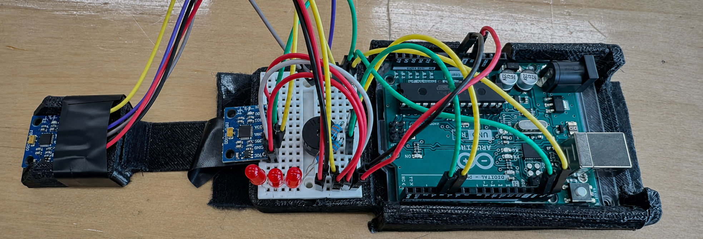

<h1>Hi, I'm Shaoxuan 👋</h1>

[简体中文](https://github.com/yuxuan-518/yuxuan-518/blob/main/README.zh-CN.md)

## Projects

### [Piezoelectric Floor Tile — Footstep Energy Harvesting](https://github.com/yuxuan-518/piezoelectric-floor-tile)

<table>
<tr>
<td width="70%" valign="top">

<p>With Shuoqi Yang and Wenhao Jia, I explored <strong>how a floor tile could transfer footstep motion to a piezoelectric disc and store the resulting electrical energy.</strong> We began by replicating a published design. When its glue-stick contacts deformed and damaged discs in our build, the problem became more specific: <strong>How could we protect the disc while delivering a more consistent mechanical input?</strong></p>

<p><strong>Design process:</strong> We replaced the glue contacts with sponge pads, then developed spring–impactor modules to explore separation and repeated contact. Variable responses in that second design led us to a center-punch-style mechanism that stores spring energy before a mechanical trigger releases it. <strong>Each revision grew from testing the previous structure and examining where its behavior differed from our expectations.</strong></p>

<p><em>Technical note: The repository includes three design generations, CAD meshes, a Python model for V2 separation and re-impact, and capacitor-charging measurements. In a single-disc comparison, V3 stored 72.48 μJ per step on average versus 11.63 μJ for the V1-derived baseline (100 steps each). The 6.23 ratio describes stored energy under the tested stepping conditions; mechanical input work was not measured.</em></p>

<p><strong>My contribution:</strong> I led the research idea, methods, and overall analysis, including early circuit work and V1/V2 measurements. I led V2 mechanism development, Python simulation, and spring-parameter selection, and revised and checked the physical model. After my teammates independently collected the V3 data, I reviewed and analyzed it and prepared the figures. I established the manuscript structure and revised the first draft into the final manuscript as first author.</p>

<p><a href="https://github.com/yuxuan-518/piezoelectric-floor-tile#design-evolution">Design evolution</a> · <a href="https://github.com/yuxuan-518/piezoelectric-floor-tile#ab-experiments">Experiments and data</a> · <a href="https://github.com/yuxuan-518/piezoelectric-floor-tile/blob/main/CREDITS.md">Team contributions</a></p>

</td>
<td width="30%" valign="top" align="center">

<p align="center"><a href="https://github.com/yuxuan-518/piezoelectric-floor-tile#readme"></a><br><sub>V3 · Assembled prototype</sub></p>

<p align="center"><a href="https://github.com/yuxuan-518/piezoelectric-floor-tile#readme"></a><br><sub>V3 · Mechanism components</sub></p>

</td>
</tr>
</table>

### [Dual-MPU6050 Posture Feedback Prototype](https://github.com/yuxuan-518/carpal-tunnel-detection)

<table width="100%">
<tr>
<td align="center">

<p align="center"><a href="https://github.com/yuxuan-518/carpal-tunnel-detection#prototype-and-demo"></a><br><sub>Dual-MPU6050 prototype · Arduino Uno and LED feedback</sub></p>

</td>
</tr>
<tr>
<td>

<p>During <strong>Cooper Union Summer STEM</strong>, Alex Wang and I noticed wrist discomfort after long hours at a computer and began researching carpal tunnel syndrome. That exploration led us to a more focused design question: <strong>Could a simple wearable help someone notice their wrist posture during computer use?</strong> <a href="https://www.nhs.uk/conditions/carpal-tunnel-syndrome/">NHS overview</a></p>

<p><strong>Design process:</strong> We narrowed the broad health concern to one behavior a prototype could respond to: the hand bending up or down relative to the forearm. We explored placing one motion sensor on the hand and another on the forearm, then using feedback to draw attention to wrist posture. This gave us a concrete idea to build and investigate.</p>

<p><em>Technical note: The prototype compares motion data from two MPU6050 sensors and provides LED feedback.</em></p>

<p><strong>My contribution:</strong> I proposed the dual-sensor design and wrote its initial MPU6050 code. I also explored vector calculations and data processing, and contributed early serial-output and feedback modules. <a href="https://github.com/yuxuan-518/carpal-tunnel-detection#team-contributions">Contribution history</a></p>

<p><a href="https://github.com/yuxuan-518/carpal-tunnel-detection#prototype-and-demo">Photo &amp; demo</a> · <a href="https://github.com/yuxuan-518/carpal-tunnel-detection#why-two-mpu6050-sensors">Design rationale</a> · <a href="https://github.com/yuxuan-518/carpal-tunnel-detection#team-contributions">Team contributions</a></p>

</td>
</tr>
</table>

### [Two Kittens in the Backyard](https://github.com/yuxuan-518/kitten-temperature-monitor)

<table width="100%">
<tr>
<td width="34%" valign="top" align="center">

<a href="https://github.com/yuxuan-518/kitten-temperature-monitor#readme"></a><br><sub>The resting box we put together for the kittens</sub><br><br>
<a href="https://github.com/yuxuan-518/kitten-temperature-monitor#readme"></a><br><sub>The two kittens resting together</sub>

</td>
<td width="66%" valign="top">

<p>One evening, as I was about to walk a classmate home, we heard loud meowing from the backyard. We followed the sound and found two kittens lying on the ground. They seemed to have been abandoned. One was very thin, the weather was cold, and insects were crawling on them. I panicked. We hurried back inside with them, warmed water to wipe their bodies and remove the insects, and prepared kitten formula.</p>

<p>There were three of us, and we divided up the work. While one friend cleaned and fed a kitten and another cut an opening in a box and lined it with soft bedding, I worked on the code and wiring. <strong>Using code from my existing Arduino IDE library, I independently completed the programming and wiring in about an hour.</strong> The device displayed the air temperature and humidity around their resting area and gave temperature alerts. I also added a fan for ventilation.</p>

<p>Afterward, we took turns looking after them. I fed them at midnight and again at 3 a.m., then went to sleep. My classmate got up at 6 and came over around 7 to take the next shift. That became the work we shared: feeding, watching, and making sure someone was there to take over.</p>

<p>One kitten died three or four days later. The other is still with me. It has cerebellar hypoplasia and walks unsteadily, but it is alive and doing well.</p>

<p><strong>What stays with me is how directly the things I had learned became useful.</strong> I was writing code while my friends were feeding the kittens and preparing their box. The late nights and handovers brought the three of us closer, too. This project belongs alongside my other work because it records a time when we had a problem in front of us and used what we had to help.</p>

<p><a href="https://github.com/yuxuan-518/kitten-temperature-monitor#readme">Project and photos</a> · <a href="https://github.com/yuxuan-518/kitten-temperature-monitor/blob/main/firmware/KittenMonitor/KittenMonitor.ino">Source code</a></p>

</td>
</tr>
</table>

### [ATmega2560 — Embedded Foundations](https://github.com/yuxuan-518/atmega2560-embedded-foundations)

After Cooper Union's six-week Summer STEM program, I realized I needed more time to organize my understanding of embedded development. While exploring Cornell's ECE curriculum, I discovered ECE 4760 and was drawn to its birdsong synthesis, digital Galton board, and feedback-control projects. **To prepare for studying this material more deeply during twelfth grade, I began asking: How could a series of progressive exercises connect scattered knowledge into a foundation I could understand and use?**

**Learning process:** Using the skills needed for ECE 4760 as a reference, I worked with GPT to break the goals into foundational ATmega2560 exercises. Starting with LEDs, buttons, and register operations, I gradually added timers, interrupts, serial communication, sensors, and motion control before bringing them together into an integrated system. **My focus gradually expanded from implementing individual functions to understanding how modules work together and why they can interfere with one another.**

*Technical note: The repository uses register-level AVR C and PlatformIO, preserving 38 project directories spanning GPIO, communication, actuator control, and system integration.*

**My contribution:** I independently searched for resources, read datasheets, and attempted the first version of the code. In some exercises, I rewrote modules by hand to revisit the principles. GPT helped explain concepts, review code, and discuss debugging. When I did not understand a proposed change, I asked further questions and returned to the documentation and code to check the explanation. The repository includes revisions made after these reviews and discussions.

[Motivation and learning progression](https://github.com/yuxuan-518/atmega2560-embedded-foundations#why-i-started) · [Selected projects and debugging](https://github.com/yuxuan-518/atmega2560-embedded-foundations#three-projects-to-explore) · [Source code](https://github.com/yuxuan-518/atmega2560-embedded-foundations/tree/main/code)

### [Kesty — Study Management App](https://github.com/yuxuan-518/kesty-support)

During application season, exam preparation, and research, students often have several large commitments competing for their time. **A goal like completing the Common App or writing a research paper is made up of many smaller pieces, not one checkbox.**

**Design idea:** Kesty lets users turn a large goal into smaller tasks and spread them across individual days. For example, a Common App goal could include the personal statement, supplemental essays, and Additional Information. An extracurricular project could include pushing code, assembling a prototype, and building a showcase website. A research paper could include organizing data, drafting sections, and deriving formulas. **The central idea is to connect each day’s work to the larger goal, so users can plan what to do now while keeping the overall project in view.**

*Technical note: Kesty is a native iOS app built with Swift and SwiftUI. It uses Codable models and `UserDefaults` for local data storage; cloud synchronization is not currently implemented.*

**My contribution:** I defined the app’s architecture, local data organization, and the structure connecting long-term goals with daily tasks. GPT assisted with writing the Swift and SwiftUI code based on the design and requirements I defined.

**[Download on the App Store](https://apps.apple.com/us/app/kesty/id6760517321)** · [Source code and demo](https://github.com/yuxuan-518/kesty-support#readme)

### [Data Visualization and Storytelling — Cooper Union](https://github.com/yuxuan-518/cooper-union-data-visualization)

During **Cooper Union STEM Saturdays: Inventor’s Lab — Data Visualization (2024)**, I practiced turning tables into charts that an audience could understand. The final project compares the share of people employed across age groups, education levels, and gender. **The charts make group differences and changes over time visible without asking viewers to read the raw data row by row.**

**Course work and learning:** The collection also includes Titanic passenger summaries, penny-mass distributions, a comparison of two chart formats, and program-selection recommendations. I practiced organizing data, calculating descriptive statistics, choosing charts for different questions, and explaining comparisons through bilingual speaking notes and a collaborative presentation.

*Technical note: The final project includes a seven-worksheet Excel analysis, a 22-slide presentation, and Chinese/English rehearsal notes. Project pages display chart previews with short explanations. The original presentation credits Shaoxuan Xiong as producer and Richard Feng as editor.*

[Final project: charts and explanation](https://github.com/yuxuan-518/cooper-union-data-visualization/tree/main/final-project/employment-analysis#readme) · [Classroom exercises](https://github.com/yuxuan-518/cooper-union-data-visualization#classroom-exercises) · [Course learning](https://github.com/yuxuan-518/cooper-union-data-visualization#what-i-practiced-during-the-course)

---

My repositories document both working prototypes and the experiments that led to them. Each project's README explains its current features, limitations, and collaborators.

## About me

```javascript
const shaoxuan = {
  interests: ["Embedded systems", "Sensors", "App development"],
  learning: ["C / AVR C", "Swift / SwiftUI"],
  hardware: ["Arduino Uno", "ATmega328P", "MPU6050"],
  approach: "Build a prototype, test it, and learn from the results"
};
```
