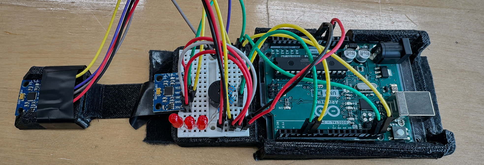

<h1>你好，我是熊少轩 👋</h1>

[English](https://github.com/yuxuan-518/yuxuan-518#readme)

## 项目

### [压电地砖——脚步能量采集](https://github.com/yuxuan-518/piezoelectric-floor-tile)

<table>
<tr>
<td width="70%" valign="top">

<p>我与 Shuoqi Yang、Wenhao Jia 一起探索：<strong>怎样通过地砖结构，将脚步运动传递给压电片，并把产生的电能储存起来？</strong> 我们从复现一篇已发表的设计开始。当胶棒接触件在我们的实物中变形并损伤压电片后，研究问题变得更具体：<strong>怎样在保护压电片的同时，让机械激励更加稳定？</strong></p>

<p><strong>设计过程：</strong> 我们先用海绵替换胶棒接触件，再开发弹簧与撞击物组成的模块，探索脱离和重复接触。第二代结构的输出波动促使我们进一步采用中心冲式机构，先压缩弹簧储能，再通过机械触发释放。<strong>每次改进都来自对上一代结构的实际测试，以及对实测行为与预期差异的分析。</strong></p>

<p><em>技术说明：仓库保留了三代结构、CAD 网格、用于 V2 脱离与再次撞击分析的 Python 模型，以及电容充电数据。在各 100 次的单片结构比较中，V3 单步平均储能为 72.48 μJ，V1 衍生基线为 11.63 μJ。6.23 倍反映测试踩踏条件下的储能比；实验未测量机械输入功。</em></p>

<p><strong>我的贡献：</strong> 我主导研究思路、方法和整体分析，负责早期电路工作及 V1/V2 测量，主导 V2 机构开发、Python 仿真和弹簧参数选择，并修订、核查物理模型。队友独立采集 V3 数据后，我负责审核、完整分析和制图。我还确定了论文整体结构，并以第一作者身份将初稿修订为最终稿。</p>

<p><a href="https://github.com/yuxuan-518/piezoelectric-floor-tile#design-evolution">结构演变</a> · <a href="https://github.com/yuxuan-518/piezoelectric-floor-tile#ab-experiments">实验与数据</a> · <a href="https://github.com/yuxuan-518/piezoelectric-floor-tile/blob/main/CREDITS.md">团队分工</a></p>

</td>
<td width="30%" valign="top" align="center">

<p align="center"><a href="https://github.com/yuxuan-518/piezoelectric-floor-tile#readme"></a><br><sub>V3 · 组装后的原型</sub></p>

<p align="center"><a href="https://github.com/yuxuan-518/piezoelectric-floor-tile#readme"></a><br><sub>V3 · 机构零部件</sub></p>

</td>
</tr>
</table>

### [双 MPU6050 姿态反馈原型](https://github.com/yuxuan-518/carpal-tunnel-detection)

<table width="100%">
<tr>
<td align="center">

<p align="center"><a href="https://github.com/yuxuan-518/carpal-tunnel-detection#prototype-and-demo"></a><br><sub>双 MPU6050 实物原型 · Arduino Uno 与 LED 反馈电路</sub></p>

</td>
</tr>
<tr>
<td>

<p>在 <strong>Cooper Union Summer STEM</strong> 期间，我和 Alex Wang 注意到长时间使用电脑后会有手腕不适，于是开始查阅腕管综合征的资料。这段探索引出了一个更具体的设计问题：<strong>能否用一个简单的可穿戴原型，帮助使用者留意电脑工作时的手腕姿势？</strong> <a href="https://www.nhs.uk/conditions/carpal-tunnel-syndrome/">NHS 症状与风险因素介绍</a></p>

<p><strong>设计思路：</strong>我们把宽泛的健康关注点收窄到一种原型可以观察的动作：手相对于前臂向上或向下弯曲。我们尝试在手部和前臂各放置一个动作传感器，并通过反馈提醒佩戴者留意手腕姿势。这样，最初的健康问题就变成了一个可以动手制作和探索的具体设计。</p>

<p><em>技术说明：原型使用两个 MPU6050 传感器比较动作数据，并通过 LED 提供反馈。</em></p>

<p><strong>我的贡献：</strong>我提出了双传感器设计并编写最初的 MPU6050 代码，也探索了向量计算和数据处理，并参与早期串口输出与反馈模块的编写。<a href="https://github.com/yuxuan-518/carpal-tunnel-detection/blob/main/README.zh-CN.md#团队分工">查看提交与团队分工</a></p>

<p><a href="https://github.com/yuxuan-518/carpal-tunnel-detection#prototype-and-demo">实物与演示</a> · <a href="https://github.com/yuxuan-518/carpal-tunnel-detection#why-two-mpu6050-sensors">设计思路</a> · <a href="https://github.com/yuxuan-518/carpal-tunnel-detection#team-contributions">团队分工</a></p>

</td>
</tr>
</table>

### [ATmega2560——嵌入式基础学习](https://github.com/yuxuan-518/atmega2560-embedded-foundations)

在 Cooper Union 的六周暑期 STEM 项目结束后，我意识到自己需要更多时间梳理嵌入式开发的基础。在浏览 Cornell 的 ECE 课程体系时，ECE 4760 中的鸟鸣合成、数字高尔顿板和反馈控制项目吸引了我。**为了在十二年级继续深入这些内容，我开始探索：怎样通过一系列渐进练习，把零散的知识连接成自己能够理解和运用的体系？**

**学习过程：**我以 ECE 4760 所需的能力为参照，借助 GPT 将目标拆成适合 ATmega2560 的基础练习。从 LED、按钮和寄存器操作开始，逐步加入定时器、中断、串口、传感器和运动控制，最后组织成综合系统。**学习重点也逐渐从实现单个功能，转向理解多个模块怎样协同运行，以及它们为什么会互相影响。**

*技术说明：仓库使用寄存器级 AVR C 和 PlatformIO，保留了从 GPIO 到通信、执行器控制与系统集成的 38 个工程目录。*

**我的贡献：**我独立搜索资料、阅读数据手册并尝试编写第一版代码，在部分练习中重新手写模块以复习原理。GPT 协助解释概念、审查代码和讨论排错；对于不理解的修改，我会继续追问原因，并回到资料与代码中核对。仓库包含这些审查和讨论之后的修改。

[学习动机与路线](https://github.com/yuxuan-518/atmega2560-embedded-foundations/blob/main/README.zh-CN.md#为什么开始) · [代表项目与排错经历](https://github.com/yuxuan-518/atmega2560-embedded-foundations/blob/main/README.zh-CN.md#三个推荐阅读的项目) · [源代码](https://github.com/yuxuan-518/atmega2560-embedded-foundations/tree/main/code)

### [Kesty — 学习管理应用](https://github.com/yuxuan-518/kesty-support)

申请季、考试准备和研究任务常常同时占用学生的时间。像完成 Common App 申请或写一篇论文这样的大目标，并不是一个待办事项，而是由许多不同的部分组成。

**设计思路：**Kesty 让用户把一个长期目标拆成具体的小任务，再分配到不同的日期。例如，Common App 目标可以拆成主文书、补充文书和 Additional Information；课外项目可以拆成上传代码、组装原型和制作展示网站；论文目标可以拆成整理数据、撰写不同部分和推导公式。**核心想法是让每天的任务都能连回长期目标，帮助用户安排眼前的工作，同时看清它们如何推动整体进展。**

*技术说明：Kesty 是一款 SwiftUI 原生 iOS 应用，使用 Codable 数据模型在设备本地保存资料、任务和计划。*

**我的贡献：**我负责应用整体架构、本地数据组织，以及长期目标与每日任务之间的结构设计。GPT 根据我提出的设计和需求，辅助编写 Swift 与 SwiftUI 代码。

**[在 App Store 下载](https://apps.apple.com/us/app/kesty/id6760517321)** · [源代码与演示](https://github.com/yuxuan-518/kesty-support#readme)

### [数据可视化与叙事 — Cooper Union](https://github.com/yuxuan-518/cooper-union-data-visualization/blob/main/README.zh-CN.md)

在 **2024 年 Cooper Union STEM Saturdays 的 Inventor’s Lab: Data Visualization 课程**中，我练习把表格整理成听众能够理解的图表。期末项目从年龄、学历和性别三个角度，比较各群体中有工作的人所占的比例。**通过图表，读者可以直接看到群体差异和时间变化，不必逐行阅读原始数据。**

**课程实践与学习收获：**材料还包括 Titanic 乘客统计、硬币质量分布、两种图表形式的比较，以及节目选择建议。我练习了整理数据、计算描述统计量、根据问题选择图表，并通过双语讲稿和合作演示向听众解释比较结果。

*技术说明：期末成果包括 7 个工作表的 Excel 分析、22 页演示文稿和中英双语排练稿。各项目页面直接展示图表预览与简短说明。原演示文稿署名为 Shaoxuan Xiong（制作）和 Richard Feng（编辑）。*

[期末项目图表与讲解](https://github.com/yuxuan-518/cooper-union-data-visualization/blob/main/final-project/employment-analysis/README.zh-CN.md) · [课堂练习](https://github.com/yuxuan-518/cooper-union-data-visualization/blob/main/README.zh-CN.md#课堂练习) · [课程学习收获](https://github.com/yuxuan-518/cooper-union-data-visualization/blob/main/README.zh-CN.md#我在这门课中练习了什么)

---

仓库中记录了原型及开发过程中的探索。各项目 README 介绍了当前功能、局限和合作成员。

## 关于我

```javascript
const shaoxuan = {
  interests: ["嵌入式系统", "传感器", "应用开发"],
  learning: ["C / AVR C", "Swift / SwiftUI"],
  hardware: ["Arduino Uno", "ATmega328P", "MPU6050"],
  approach: "制作原型，实际测试，从结果中学习"
};
```
